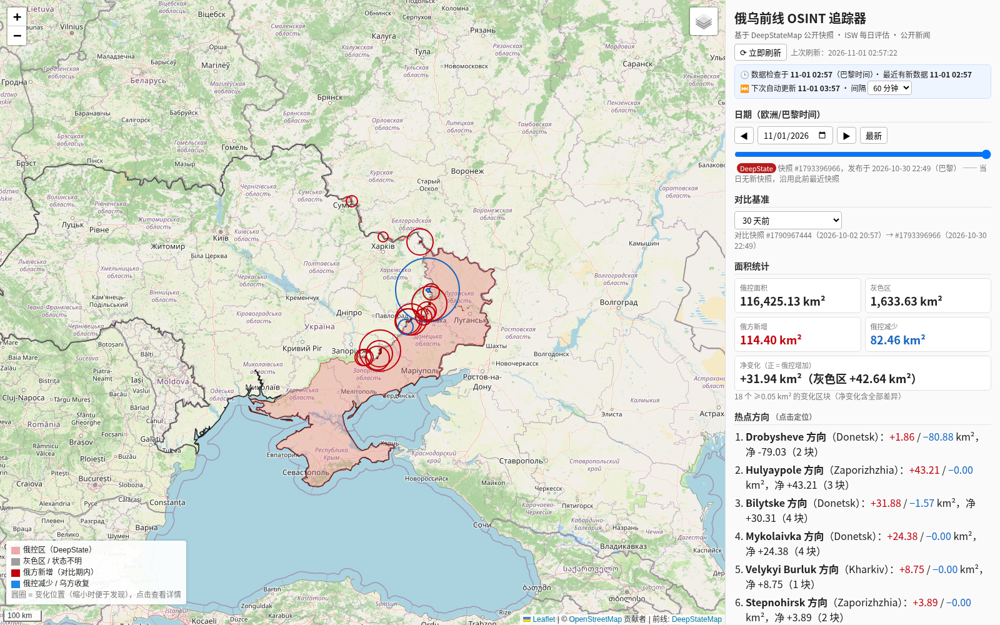

# 俄乌前线 OSINT 追踪器（本地软件）

一个在你自己电脑上运行的交互式网页应用：根据 **真实公开数据** 展示俄乌前线（DeepStateMap 俄控区 / 灰色区）及其每日变化，
并汇总所选日期的 ISW 每日评估要点与公开新闻标题。**不做任何推测或模拟。**



## 免安装版（推荐给不熟悉电脑的同学）

在 GitHub 仓库的 **Releases** 页面（或 Actions 构建的 Artifacts）下载对应压缩包，**不需要安装 Python**：

| 系统 | 下载 | 打开方式 |
|---|---|---|
| macOS（M1/M2/M3/M4 芯片） | `UkraineFront-macos-arm64.zip` | 双击解压得到 `UkraineFront.app`，建议拖到“应用程序”文件夹 |
| macOS（Intel 芯片） | `UkraineFront-macos-x64.zip` | 同上 |
| Windows 10/11 | `UkraineFront-windows-x64.zip` | 右键 → “全部解压缩”，打开解压出的 `UkraineFront` 文件夹，双击 `UkraineFront.exe` |

> 不确定 Mac 是哪种芯片：点屏幕左上角的苹果图标 → “关于本机”，“芯片”写 Apple M… 就选 arm64，写 Intel 就选 x64。
>
> 最低系统版本不是“打包那台电脑的系统版本”。每个 App 会按实际带上的库声明自己的最低 macOS 版本（写在 Release 说明里，也写在 App 的“最低系统版本”里）。Apple 芯片的包不能在 Intel Mac 上运行；Intel 包可以在 Intel Mac 上运行，也可以在 Apple 芯片的 Mac 上通过 Rosetta 2 运行。

启动后会弹出一个 **黑色窗口**（Mac 上是“终端”窗口），并自动打开浏览器 http://localhost:8765/ （端口被占用时会自动换一个，窗口里会显示实际地址）。
**使用期间不要关闭这个黑色窗口；关闭它就是退出软件。** 再次双击时如果软件已在运行，只会重新打开浏览器页面。

### Mac 第一次打开（软件未经 Apple 签名，系统会拦截一次）

1. 第一次 **不要直接双击**：在“访达”里 **按住 Control 键点按（或右键）`UkraineFront.app` → 选“打开”** → 在弹窗里再点 **“打开”**。
2. 如果弹窗里没有“打开”按钮（较新的 macOS 15/26 常见）：先双击一次让它被拦截，然后打开
   **系统设置 → 隐私与安全性**，在页面下方找到“已阻止使用 UkraineFront”，点 **“仍要打开”**，输入开机密码确认，再双击一次即可。
3. 只需做一次，以后直接双击。系统可能询问是否允许“终端”运行，点“好”。
4. 仍然打不开（提示“已损坏”）时，可在“终端”里执行下面一行后再双击（把路径换成 app 实际位置）：
   `xattr -dr com.apple.quarantine /Applications/UkraineFront.app`

### Windows 第一次打开

Windows 可能弹出蓝色的 “Windows 已保护你的电脑”（SmartScreen）：点 **“更多信息” → “仍要运行”**。
杀毒软件如误报，请选择“允许”。务必先**解压**再运行，不要在压缩包里直接双击。

### 数据保存在哪里

软件自带一份种子数据，第一次启动时复制到你的用户目录，之后的自动更新也保存在这里（删除这个文件夹即可恢复初始状态）：

- macOS：`~/Library/Application Support/UkraineFront`（访达 → 前往 → 前往文件夹，粘贴此路径）
- Windows：`%APPDATA%\UkraineFront`（在资源管理器地址栏粘贴）
- Linux：`~/.local/share/UkraineFront`

首次启动会联网补齐最新数据（约 10–60 秒，页面先显示自带数据）。命令行日报（`ukraine_front.daily`）不包含在免安装版里，需要用下面的源码方式运行。

### 自己打包（开发者）

```
pip install -r requirements.txt pyinstaller
python packaging/build.py          # 生成 dist/UkraineFront(.app) 和 dist/UkraineFront-<系统>-<架构>.zip
```
推送 `v*` 标签（如 `git tag v1.0.0 && git push --tags`）后，GitHub Actions（`.github/workflows/build.yml`）会自动在
macOS（Apple 芯片 + Intel）和 Windows 上构建。两个 macOS 压缩包会先挂到 Release（Windows 失败不会挡住这次发布）；Windows 构建成功后再把 Windows 压缩包补到同一个 Release。也可在 Actions 页面手动运行 “Build apps”（手动运行只产生可下载的 Artifacts，不发布 Release）。

## 一键启动

需要 **Python 3.10 或更高版本**（https://www.python.org/downloads/ ，Windows 安装时勾选 “Add python.exe to PATH”）。

| 系统 | 操作 |
|---|---|
| Windows | 解压后双击 `start.bat`（会自动查找 `py -3` 启动器或 PATH 中的 python） |
| macOS | 双击 `start.command`（首次如被拦截：右键 → 打开）；或在终端运行 `bash start.sh` |
| Linux | 终端进入解压目录，运行 `bash start.sh` |
| Docker（可选） | `docker build -t ukraine-front . && docker run -p 8765:8765 -v uf-data:/app/data ukraine-front`，然后打开 http://localhost:8765 |

首次运行会自动创建 `.venv` 虚拟环境并安装依赖（需联网，约 1–3 分钟），随后启动服务并自动打开浏览器
http://localhost:8765/ 。关闭终端窗口（或按 Ctrl+C）即可退出。端口被占用时可先设置环境变量 `UF_PORT=8899` 再启动。

## 后台自动更新

- 软件运行期间，后台调度器默认 **每 60 分钟** 自动获取新的 DeepState 快照、ISW 要点和新闻（不阻塞页面访问，不会重叠运行）。
- 间隔可在页面顶部的“间隔”下拉框修改（保存在本机 `data/settings.json`），或启动前设置环境变量
  `UF_REFRESH_MINUTES`（例如 `UF_REFRESH_MINUTES=30 bash start.sh`；Windows：`set UF_REFRESH_MINUTES=30` 后再运行 start.bat）。设为 0 关闭。
- 启动时如果数据已过期（距上次检查超过一个间隔）会立即在后台更新。
- 页面每分钟检查一次数据版本；有新数据时自动刷新视图（保留地图缩放和对比设置；若你正在看“最新”日期，会自动跳到新的最新日期），并显示
  “数据检查于 HH:MM（巴黎时间）· 下次自动更新 HH:MM”。
- 运行日志：`data/logs/app.log`。
- **只有软件在运行、电脑未休眠时才会更新**；关闭后再次启动会先补一次更新。

## 功能

- **可缩放交互地图**（Leaflet + CARTO/OSM 底图；CARTO 加载失败会自动切换到 OSM，并始终显示本地 Natural Earth 国界）：
  俄控区、灰色区、对比期内的 🔴 俄方新增 / 🔵 俄控减少区域，以及便于在小比例尺下发现的变化圆圈。
- **点击变化区域**：面积 km²、最近居民点（GeoNames）、出现于哪一天的快照、附近 6 km 内的 DeepState 官方更新说明、DeepStateMap 链接。
- **日期滑块 / 日期选择**：覆盖 **全面战争以来（2022-02-24 至今）** 的每一天（每天取欧洲/巴黎时间当天结束前的最后一个快照）。
  - 2022-02-24 至 2022-04-02：DeepState 公开历史尚未开始（其最早快照为 2022-04-03），使用 **ISW/CTP 公开 ArcGIS 图层
    “Russian Assessed Control of Terrain February to November”** 的每日评估控制区（无灰色区；页面以橙色 “ISW” 标记）。
  - 2022-04-03 起：DeepStateMap。两者口径不同，04-03 的切换不计入日变化/累计变化。
  - 压缩包内附带全部每日指标（`data/daily_metrics.csv`）、2022 年初 ISW 控制区（约 2.4 MB）和最近约 14 天的 DeepState 快照（启动后后台会自动补齐最近 31 天）；
    查看更早日期的地图时会按需在线下载对应快照（每个约 0.1–0.6 MB，下载后缓存）。
- **全面战争时间线**：俄控面积曲线（ISW 段橙色、DeepState 段红色）、自 2022-02-24 起的累计净变化、每日净变化；可切换 30 天 / 半年 / 1 年 / 全部。
- **对比基准**：上一次 DeepState 更新 / 1 天 / 7 天 / 30 天 / 自定义日期。
- **侧栏**：俄控面积、灰色区、俄方新增、俄控减少、净变化；热点方向（15 km 聚类，点击定位）；累计变化时间线（点击跳转日期）；
  区间内 DeepState 更新说明原文；所选日期的 ISW《Russian Offensive Campaign Assessment》要点（英文原文 + 链接）；新闻标题（链接）；数据源状态。
- **刷新数据** 按钮；启动时自动在后台获取最新快照。任何来源不可用时自动降级（使用本地缓存）并在“数据源状态”中说明。
- 命令行日报（静态 PNG 地图 + 时间线 + 中文 Markdown 报告）：
  `.venv/bin/python -m ukraine_front.daily`（Windows：`.venv\Scripts\python -m ukraine_front.daily`），输出到 `output/YYYY-MM-DD/`。

## 援助与政治（新标签页）

侧栏顶部切换到 **“🤝 援助与政治”**，内容随所选日期联动（窗口可选 仅当天 / ±1 / ±3 / ±7 / ±15 天）：

- **援助条目**（来源：Kiel Institute *Ukraine Support Tracker*，主表 “Bilateral Assistance, MAIN DATA”）：
  日期、援助方、类型（军事 / 经济·金融 / 人道）、已分配或承诺、金额（欧元）及金额依据（来源给出 / Kiel 按装备单价估算 / 未披露）、
  装备清单、英文原文说明、原始来源链接、Kiel ID。同一公告（activity）的多个子条目合并为一条。可按类型、分配/承诺筛选。
- **截至所选日期的累计援助**：合计、军事、经济/金融、人道，以及前 10 大援助方（只计 *已分配* allocations；多年期 *承诺* 单独提示，不相加）。
- **战争期间累计援助图**（十亿欧元，按宣布日期堆叠），可叠加俄控面积曲线；竖线 = 所选日期，点击跳转。
- **援助与政治新闻**：Google News RSS 按日期检索的英文标题（两组关键词：aid/weapons/loan/package/humanitarian/military；
  sanctions/talks/ceasefire/NATO/summit），按标题关键词 **自动分类** 为 军事 / 经济·金融 / 人道 / 政治 / 其他（可能有误，已标注“自动分类”），可按类别筛选。
- 顶部显示 Kiel 数据的版本、覆盖截止日期和滞后天数；所选日期晚于 Kiel 覆盖范围时会提示“尚未录入”。

数据文件（随包附带，紧凑）：`data/aid/aid_events.csv.gz`（Kiel 每个子条目一行：date, donor, category, aid_type, measure, value_eur, value_basis,
item, item_numb, description, source_url, source_name, activity_id…）、`data/aid/aid_meta.json`、`data/aid/news_events.csv.gz`
（date, title, outlet, url, category, cats, query, auto_classified；每天最多 15 条，按类别均衡）。
后台更新：Kiel 页面 **每 24 小时最多检查一次** 新版本（`UF_KIEL_CHECK_HOURS` 可改），有新 XLSX 才下载（约 13 MB，需要 openpyxl）并重建表；
新闻在每次自动更新时重新获取最近 3 天（每次约 4 个请求，间隔 ≥2 秒），并补齐索引最后日期之后的缺口（每次最多 15 个窗口）。
索引中缺少的日期会在打开时按需检索（每次最多 4 个窗口）。全量回填脚本：`python tools/backfill_news.py [开始日期] [结束日期]`（可断点续跑）。

**“每一笔援助”的真实含义**：Kiel 只收录 **41 个国家政府 + 欧盟机构** 的政府间援助（含 2022-01-24 起的少量战前承诺），
不含私人/企业/NGO 捐赠、红十字会/联合国等国际组织自身资金、IMF/世界银行贷款（除非由捐助国出资）；
部分军事援助 **未公开金额**：Release 31 中 3,097 个已分配子活动里有 221 个（约 7%）完全没有金额，另有约 1,000 行由 Kiel 按装备单价估算（Kiel 每件装备一行，金额只写在子活动的一行上，所以“按行”看约一半为空并不代表未披露）；机密援助不可见；
部分条目只有区间日期（如 “until 12/31/2022”），按区间末日归档并注明；Kiel 每 1–2 个月发布一次，通常滞后 2–3 个月；
不同版本会回溯修订。

## 数据来源

| 来源 | 用途 | 说明 |
|---|---|---|
| DeepStateMap 公开 API `deepstatemap.live/api/history/public`、`/api/history/{id}/geojson` | 俄控区 / 灰色区多边形与官方更新说明（2022-04-03 起） | 核心数据 |
| ISW/CTP ArcGIS FeatureServer “Russian Assessed Control of Terrain February to November”（services5.arcgis.com/SaBe5HMtmnbqSWlu） | 2022-02-24 至 04-02 的评估控制区 | 已按日合并并简化（约 30 m） |
| ISW 每日评估（经 AEI Critical Threats Project 在 criticalthreats.org 同步发布版） | Key Takeaways 原文 | ISW 官网对脚本访问有 Cloudflare 验证；失败时退回 Google News 标题 |
| Kyiv Independent、BBC Europe RSS；Google News RSS 搜索 | 新闻标题 | 历史日期使用 Google News 日期检索 |
| Kiel Institute Ukraine Support Tracker（kielinstitut.de，XLSX，Release 31：2022-01-24 至 2026-08-31） | 援助条目、累计援助、援助方排名 | 仅限新闻、科研、编辑用途（Kiel 使用条款） |
| Google News RSS 日期检索（news.google.com/rss/search，after:/before:） | 援助与政治新闻标题（2022-02-24 起） | 关键词自动分类；链接为 Google News 跳转链接 |
| Natural Earth 10m（乌克兰视角）、GeoNames UA（CC BY 4.0） | 国界、地名 | 压缩包已附带 |
| CARTO / OpenStreetMap | 底图瓦片 | © OpenStreetMap 贡献者 © CARTO |

## 方法

- 俄控区 = DeepState “Occupied” 多边形 ∪ 克里米亚 ∪ 2014 年后占领区 ∪ 图兹拉岛，裁剪到乌克兰国界 +1 km；灰色区 = “Unknown status / Під питанням” 多边形（不计入俄控）。
  DeepState 历史数据的要素名称在不同时期格式不同且部分损坏，因此主要按其固定的填充颜色分类；2022 年的 GeometryCollection 也已展开处理。
  若某快照未绘制克里米亚/2014 年后占领区，会用基线多边形补齐并在指标备注中注明（在当前数据中未触发）。
- 面积在 EPSG:6933 等积投影下计算；变化列表忽略 < 0.05 km² 的碎片（多为绘图修正），但净变化数字包含全部差异。
- DeepState 并非每天更新；未更新的日子变化为 0，变化计入下一次更新。

## 免责声明 / 局限

- 本工具仅汇总 **公开来源（OSINT）**，**不是情报产品**，不代表任何一方立场。
- DeepState 地图通常滞后实际战况 1–3 天，并可能事后修订；本工具按快照 ID 缓存，不会自动重新下载已修订的旧快照。
- “俄方新增 / 俄控减少”仅指地图多边形变化，可能包含绘图修正；不同 OSINT 地图口径不同，数值不能直接互比。
- 地名为最近的 GeoNames 居民点，仅用于定位，不代表该居民点易手；DeepState 说明按 6 km 距离匹配，可能包含邻近变化的说明。
- ISW 要点与新闻标题保留英文原文（未机器翻译）。部分 ISW 页面网址带随机后缀，较早日期可能只能找到前一天的报告。
- 2022 年 4 月 DeepState 仍在逐步补绘已占领区域，期间的日变化部分反映的是“补绘”而非实际推进；ISW 与 DeepState 口径不同，不可直接拼接比较。
- 后台更新只在软件运行、电脑未休眠时进行。criticalthreats.org 偶尔会对自动访问启用 Cloudflare 验证（返回 403），此时显示最近一次成功获取的 ISW 报告或仅显示标题，并暂停访问 1 小时。

## 目录

```
start.bat / start.sh / start.command / Dockerfile / requirements.txt / run_daily.sh
ukraine_front/        Python 包：app.py（网页服务）、daily.py（命令行日报）、deepstate/geo/isw/news/core/render
ukraine_front/web/    前端（Leaflet、Chart.js 已本地化）
data/                 缓存：daily_metrics.csv（每日指标）、snapshots/（DeepState 原始快照）、cache/、static/
output/               命令行日报示例输出
screenshots/          界面截图
data/aid/             援助表与新闻索引（csv.gz）
tools/backfill_news.py  援助/政治新闻全量回填（礼貌限速、可续跑）
tools/screenshots.py  可选：用 playwright 截图（需另行 pip install playwright）
launcher.py           免安装版入口（用户数据目录、自动选端口、打开浏览器）
packaging/            PyInstaller 配置（ukraine_front.spec）与一键打包脚本 build.py
tools/make_seed.py    挑选打包进免安装版的种子数据（→ build/seed_data）
.github/workflows/build.yml  GitHub Actions：macOS / Windows 自动打包与发布
```
